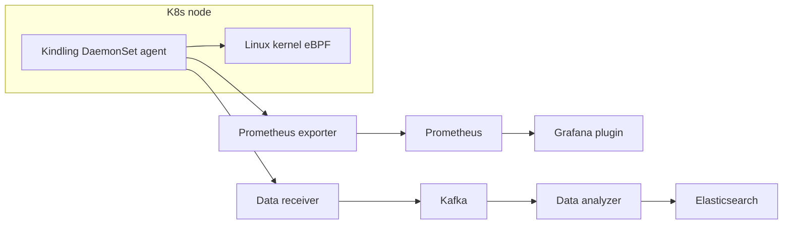

# Kindling

 

Visit our [Kindling website](http://kindling.harmonycloud.cn/) for more information.

## What is Kindling

Kindling is an eBPF-based cloud native monitoring tool for network flows in Kubernetes. It provides a service map and built-in dashboards for TCP retransmit, DNS, throughput, and TPS. It also analyzes one RPC call and shows a timing breakdown similar to the network panel in Chrome, so you can see which part of the request to investigate.

## Architecture

From a high-level view, the agent runs as a DaemonSet in Kubernetes. It collects syscalls and other tracepoints. A Prometheus exporter stores the metrics in Prometheus and displays them with the Grafana plugin.

## Linux kernel version support

The Kindling eBPF module depends on a kernel newer than 4.14. As an eBPF constraint, the eBPF module can't work for older kernel versions. For users who want to try the functionality with an old kernel, we use the kernel module from the Sysdig open-source project with enhancement and verification. The idea is to use a kernel module for tracking kernel tracepoints. Thanks to the Sysdig open-source project, it provides a tracepoint instrument framework for older kernel versions.

For now, the kernel module works as expected as the eBPF module during our test, but it is recommended to use the eBPF module in the production environment as it is safer than the kernel module. In order to help the older kernel version user experience the eBPF magic, we also support the kernel model. And you are welcome to report issues with the kernel module. For functionality, the kernel module and eBPF module capture the same data and behave exactly the same. 

## Why do we build Kindling?

When we talk about observability, we already have plenty of tools to use, like Skywalking for tracing, ELK for logging, and Prometheus for metrics. Why do we need to build an eBPF-based monitoring tool?

The majority issue for user adoption of k8s is the complexity. For the applications on Kubernetes, we don't know the network flows between the services until we can instrument the apps. We can't tell which part to blame when there is a product issue arise. Do we configure Kubernetes correctly? Are there any bugs in the virtual network like Calico or Flannel that caused this problem? Does the application code cause this issue?

We are a company based in Hangzhou, China, and used to provide Kubernetes distribution for our customers. Our customers used to have those questions, and we don't have proper solutions to answer those questions.

APM(Application Performance Monitoring) is good for those applications in Java which can be instrumented automatically, while for the Go programs, the code has to be rewritten for instrumenting. And even if we adopt the APM solution, we still can't tell whether an issue is caused by network problems, and many issues can’t be pinpoint the root cause easily.

We found it may be helpful that we triage the issue first by checking the issue from the network view to identify issues roughly like "oh, it's a network problem, the code works fine, and we should dig into the configuration of calico" or "the infrastructure works fine, so the app code should be blamed, let's dig into the logs or the APM dashboard for further information".

### Why eBPF?

The libpcap way of analyzing the flows in the Kubernetes environment is too expensive for the CPU and network. The eBPF way of data capture cost much less than libpcap. eBPF is the most popular technology to track the Linux kernel where the virtual network, built by veth-pair and iptables, works. So eBPF is a proper technique to be used for tracking how the kernel responds to application requests.

## Core Features

Kindling can be easily integrated with Prometheus, and we uses PromQL to query the data in the frontend, so it should be adopted easily. But due to the cardinality constraint of Prometheus, we group the detailed data into buckets which throw away the detailed information.

## Get started

You can deploy Kindling easily, check out the [Installation Guide](http://kindling.harmonycloud.cn/docs/installation/kindling-agent/requirements/) for details.

## Documentation

The Kindling documentation is available on our [Kindling website](http://kindling.harmonycloud.cn/docs/overview-and-concepts/overview/)

## Contributing 

Contributions are welcome, you can contribute in many ways: report issues, help us reproduce issues, fix bugs, add features, give us advice on GitHub discussion, and so on. If you are interested in joining us to unveil the eBPF in the Kubernetes area, you can start by reading the [Contributing Guide](https://github.com/KindlingProject/kindling/blob/main/CONTRIBUTING.md).

## Contact

If you have questions or ideas, please feel free to reach out to us in the following ways:

- Check out the [discussions](https://github.com/KindlingProject/kindling/discussions)
- Join the Kindling [Slack channel](https://join.slack.com/t/kindling-world/shared_invite/zt-1rmki34l0-JiFpWFR7YhqlXG~mSQQAtg)
- Join the WeChat Group (in Chinese)

## License

Kindling is distributed under [Apache License, Version2.0](https://github.com/KindlingProject/kindling/blob/main/LICENSE).

